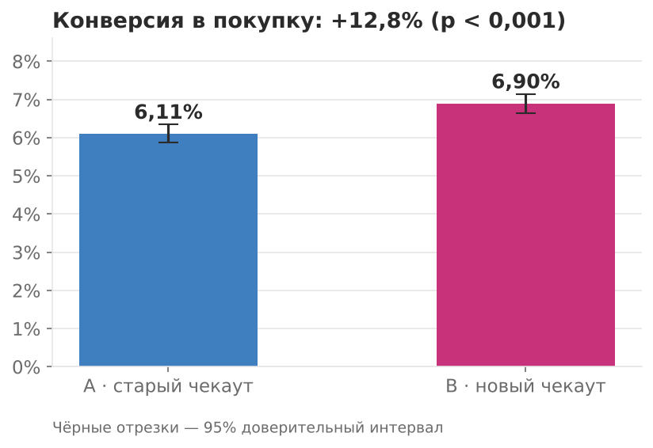
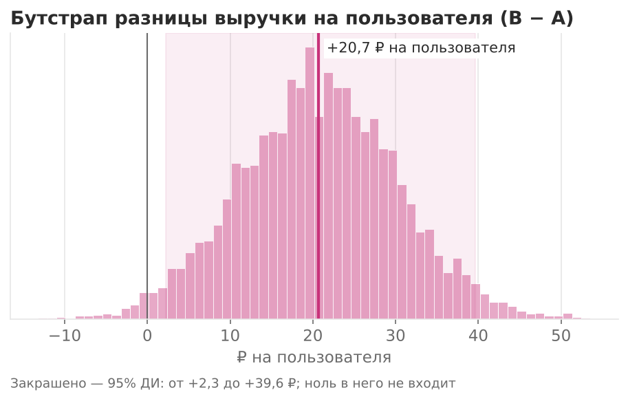
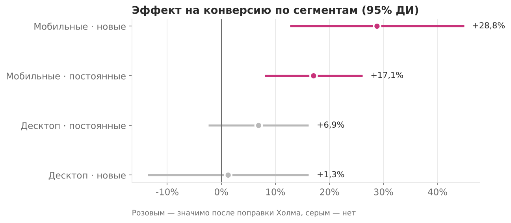
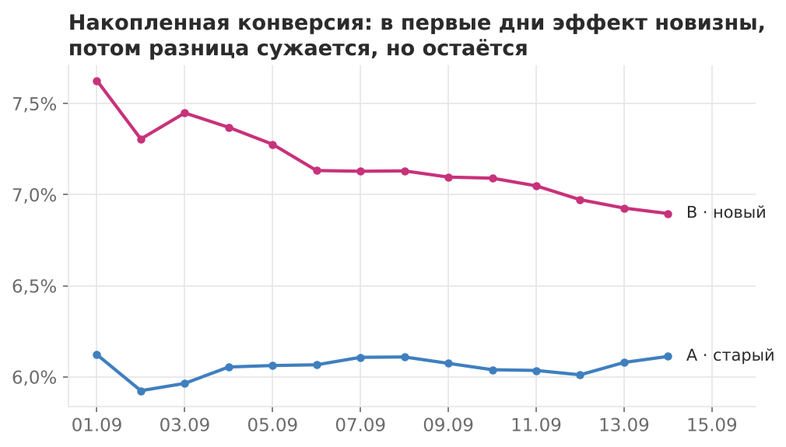

# A/B-тест нового чекаута: выкатывать или нет?


Полный разбор A/B-теста — от проверки данных до решения для бизнеса.
SQL-запросы для метрик, статистика на Python и вывод, который можно отнести руководителю.

**Стек:** SQL (DuckDB, совместим с PostgreSQL) · Python · pandas · SciPy · statsmodels · matplotlib · pytest

📓 Весь анализ с пояснениями — в ноутбуке [`analysis.ipynb`](analysis.ipynb).

---

## Задача

Интернет-магазин заменил оформление заказа из трёх шагов на одностраничное.
Тест шёл **14 дней**, участвовали **~80 000 пользователей** (сплит 50/50).

| Метрика | Роль |
|---|---|
| Конверсия в покупку | главная |
| Выручка на пользователя (ARPU) | вторая |
| Средний чек, доля возвратов | защитные — не должны ухудшиться |

## Результат

> **Решение: выкатывать.** Конверсия **+12,8%** (95% ДИ +7…+18%, p < 0,001),
> выручка на пользователя **+7–8%**. Весь эффект — на мобильных устройствах.



| | A — старый | B — новый | Эффект | p-value |
|---|---|---|---|---|
| Конверсия | 6,11% | 6,90% | **+12,8%** | < 0,001 |
| ARPU, сырой | 318,8 ₽ | 337,1 ₽ | +5,7% | 0,31 — незначимо |
| ARPU, винзоризация 99,5% | 259,1 ₽ | 279,8 ₽ | **+8,0%** | 0,03 |
| ARPU, винзоризация + CUPED | 260,2 ₽ | 278,7 ₽ | **+7,1%** | 0,04 |
| Средний чек | 5 003 ₽ | 4 700 ₽ | −6,1% | — |
| Доля возвратов | 5,74% | 6,39% | — | 0,30 — незначимо |

## Как шёл анализ

**1. Проверка данных.** 240 пользователей видели обе версии чекаута (утечка сплита) — исключены
([`sql/01_split_leak.sql`](sql/01_split_leak.sql)). Метрики на пользователя собираются одним SQL-запросом
([`sql/02_user_metrics.sql`](sql/02_user_metrics.sql)): только заказы после попадания в тест, возвраты не считаются в выручку.

**2. SRM-проверка.** Доля группы A — 50,07%, хи-квадрат p = 0,68 — сплит не сломан.

**3. Мощность.** При ~40 тыс. пользователей в группе тест замечает эффект от **0,47 п.п.** (~8% относительно).

**4. Конверсия** — z-тест для долей с доверительным интервалом относительного прироста.

**5. Выручка на пользователя.** У выручки тяжёлый хвост — редкие оптовые заказы на десятки тысяч рублей.
Из-за них обычный t-тест не видит эффекта (p = 0,31). Поэтому:
- **винзоризация** — обрезаем выручку пользователя на 99,5-м перцентиле;
- **бутстрап** — проверка без допущений о распределении: +20,7 ₽, ДИ [+2,3; +39,6];
- **CUPED** — выручка пользователя за 30 дней до теста как ковариата: дисперсия ниже на ~9%, интервал уже.

Все три метода дают один вывод: эффект положительный.



**6. Защитные метрики.** Средний чек ниже на ~6%: простой чекаут «дожимает» покупателей с небольшими корзинами.
Но покупателей стало настолько больше, что выручка на пользователя растёт. Возвраты не изменились.

**7. Сегменты** — 4 сравнения, поэтому поправка Холма на множественные проверки.



Эффект создают мобильные пользователи (+17% у постоянных, +29% у новых). На десктопе изменение незначимо:
старый чекаут на большом экране и так был удобным.

**8. Эффект новизны.** В первые дни разница больше, к концу теста сужается, но остаётся стабильно выше нуля.



## Рекомендации

1. Выкатить новый чекаут. Если ресурсы ограничены — начать с мобильной версии.
2. После выкатки 3–4 недели следить за конверсией: часть эффекта может быть новизной.
3. Добавить допродажи в новый чекаут (например, «добавьте до бесплатной доставки»), чтобы вернуть часть среднего чека.
4. Эффект на десктопе не доказан: прирост меньше ~8% этот тест заметить не мог.

## Структура

```
├── analysis.ipynb        # весь анализ с пояснениями
├── ab/
│   ├── generate.py       # генерация данных эксперимента
│   ├── data.py           # загрузка CSV и выполнение SQL через DuckDB
│   ├── stats.py          # SRM, z-тест, Уэлч, бутстрап, CUPED, MDE, Холм
│   └── analysis.py       # полный прогон + графики
├── sql/                  # запросы для метрик (совместимы с PostgreSQL)
├── data/                 # exposures.csv, orders.csv
├── images/               # графики для отчёта
└── tests/test_stats.py   # проверка статистики против statsmodels
```

## Запуск

```bash
pip install -r requirements.txt
python -m ab.generate     # пересоздать данные (необязательно, они уже в data/)
python -m ab.analysis     # отчёт в консоль + графики в images/
pytest -q                 # тесты статистических функций
```

## О данных

Данные синтетические: сгенерированы скриптом [`ab/generate.py`](ab/generate.py), чтобы проект можно было
выложить публично. В них специально заложены проблемы реальных экспериментов — утечка сплита,
выбросы в выручке, разный эффект по сегментам и эффект новизны, — которые аналитик должен найти сам.

---

Автор: Мария Вилькевичуте · [GitHub](https://github.com/mvilkevichute-2023)
